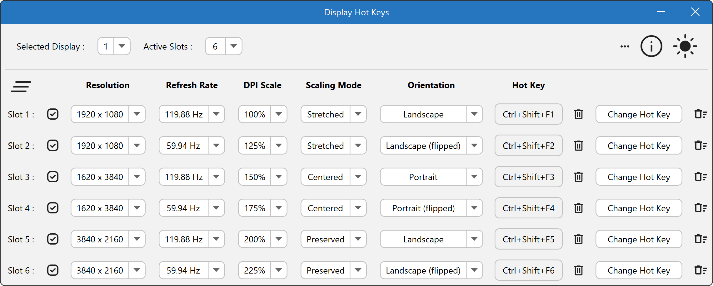

<!-- PROJECT LOGO -->

  
   
  <h3 align="center">Display Hot Keys</h3>
  

    <i>Effortlessly control display settings!</i>
     
    <a href="https://github.com/jon-mil-92/DisplayHotKeys/issues">Report Bug</a>
    <b>·</b>
    <a href="https://github.com/jon-mil-92/DisplayHotKeys/issues">Request Feature</a>
    <b>·</b>
    <a href="https://github.com/jon-mil-92/DisplayHotKeys/releases">Releases</a>
  

## Table of Contents
<ol>
  <li><a href="#about-the-project">About The Project</a></li>
  <li><a href="#getting-started">Getting Started</a></li>
  <li><a href="#usage">Usage</a></li>
  <li><a href="#roadmap">Roadmap</a></li>
  <li><a href="#license">License</a></li>
  <li><a href="#contact">Contact</a></li>
  <li><a href="#dependencies">Dependencies</a></li>
  <li><a href="#antivirus-notice">Antivirus Notice</a></li>
</ol>

## About The Project

This project was created to circumvent the tedious navigation of the Windows settings menus to change display settings. With Display Hot Keys, the display resolution, refresh rate, DPI scale percentage, scaling mode, and orientation can be changed for each connected display with user-defined hot keys.

### Common Use Cases

* Switch refresh rates to quickly enable the Black Frame Insertion or Backlight Strobing capabilities of the display.

* Easily rotate the display orientation with hot keys.

* Quickly switch between resolutions with different aspect ratios.

* Immediately apply a resolution without entering the in-game menus for video game benchmarking purposes.

* Enlarge or shrink the elements on screen by instantly changing the DPI scale percentage.

* Instantly set resolution and refresh rate while in a video game if it does not support changing these settings while in-game.

* Retain your intended display arrangement while changing display resolutions.

* Change settings for multiple displays at the same time with one hot key press.

## Getting Started

This application was made only for the Windows platform. Display Hot Keys also uses elevated privileges to set display settings while in video games and when an app with elevated privileges has focus. Therefore, if you have UAC enabled, you will get a UAC prompt the first time you launch the application. That first launch registers a Windows task that starts Display Hot Keys with the privileges it needs, so every launch after that starts the application without a UAC prompt. The sections that follow will help you get the application up and running on your PC!

**Note:** Always start Display Hot Keys from the shortcut created by the installer, or from DisplayHotKeysLauncher.exe in the application folder. Only the launcher can start the application through the Windows task, which is what avoids the prompt. Starting DisplayHotKeys.exe yourself asks Windows for elevated privileges directly, so it prompts every time no matter how often you run it.

**Note:** Registering the Windows task requires administrator rights. If you are signed in with a standard user account, the task cannot be registered and you will get a UAC prompt on every launch. If you no longer wish to see this prompt, you can [disable UAC].

### Prerequisites

* Native Windows 10 x64 or Windows 11 x64 operating system installation. Running the app through virtualization software is not fully supported.

### Installation

This application is distributed as a portable package and as an installer. You only need one of them.

#### Portable

1. Download the zip archive.

2. Unzip the archive.

3. Double-click the DisplayHotKeysLauncher executable file or create a shortcut to the launcher to run the application.

#### Installer

1. Download the installer.

2. Run the installer.

3. Follow the installer prompts.

4. Double-click the created shortcut or the DisplayHotKeysLauncher executable file in the install directory to run the application.

### Uninstalling

#### Portable

1. Double-click the uninstall.bat file in the application folder, and accept the UAC prompt.

2. Choose whether to also delete the saved settings. Keeping them preserves your saved slots.

3. Delete the application folder once the cleanup is complete.

**Note:** The uninstall.bat file closes the running application and removes the Windows task and the "Run on Startup" entry, which deleting the folder alone would leave behind.

#### Installer

1. Open "Installed apps" (Windows 11) or "Apps & features" (Windows 10) in the Windows settings.

2. Uninstall Display Hot Keys.

3. Choose whether to also delete the saved settings for all users. Keeping them preserves your saved slots if you reinstall.

<a href="#readme-top">Back to Top</a>&thinsp; &#x25B2;

## Usage

### Setting Hot Keys

1. Click the "Change Hot Key" button.

2. Press the key combination for the hot key. (Up to three keys can be used!)

3. Release at least one of the keys to set the hot key.

**Note:** A hot key cannot be a subset of another hot key. For example, you cannot have a hot key of "Ctrl+F1" and another hot key of "Ctrl+Shift+F1". However, a hot key can be the same as another hot key if they are for different displays. This will allow you to apply display settings for multiple displays with one hot key!

### Changing the Selected Display

1. Click the "Selected Display" drop-down box.

2. Select the display number you want to change hot keys for.

**Note:** The application automatically detects when a display is connected or disconnected, and it refreshes to reflect the new display configuration.

### Changing the Number of Active Hot Key Slots for a Display

1. Click the "Active Slots" drop-down box.

2. Select the number of hot key slots to show.

**Note:** There can be up to 12 active hot key slots for each connected display.

### Selecting Display Settings

1. Select a resolution value in the "Resolution" drop-down box for the hot key slot.

2. Select a refresh rate value in the "Refresh Rate" drop-down box for the hot key slot.

3. Select a DPI scale percentage value in the "DPI Scale" drop-down box for the hot key slot.

4. Select a scaling mode value in the "Scaling Mode" drop-down box for the hot key slot.

    * Select "Preserved" to preserve the aspect ratio of the image.

    * Select "Stretched" to stretch the image to the edges of the panel.

    * Select "Centered" to center the image in the middle of the panel without scaling.

**Note:** You may need to use GPU Scaling in your display driver settings to prevent the display from overriding the scaling mode.

**Note:** Scaling modes that only exist in a display driver, such as NVIDIA's "Integer Scaling", are reported to Windows as aspect ratio scaling. Display Hot Keys shows these modes as "Preserved".

5. Select a display orientation value in the "Orientation" drop-down box for the hot key slot.

    * Select "Landscape" for a landscape orientation of no rotation.

    * Select "Portrait" for a portrait orientation of 90 degrees rotation.

    * Select "Landscape (flipped)" for a flipped landscape orientation of 180 degrees rotation.

    * Select "Portrait (flipped)" for a flipped portrait orientation of 270 degrees rotation.

**Note:** Make sure you can rotate your display before changing the orientation; otherwise, it may be difficult to operate your computer.

### Changing the Language

1. Click the "Additional Settings" button.

2. Click the "Language" drop-down box.

3. Select a language, and confirm the change.

The language works as follows:

* After every install, the application uses the language chosen in the installer.

* The first time the portable package starts, it uses your Windows display language. If that language is not supported, it uses English.

* A language selected in the application is kept when the application restarts.

* Uninstalling through the Windows settings uses the language chosen in the installer.

* The uninstall.bat file in the portable package uses the same language as the application.

* The legal notices and the license are shown in English in every language.

#### Supported Languages

* English

* Deutsch (German)

* Español (Spanish)

* Français (French)

* Italiano (Italian)

* Português (Brazilian Portuguese)

* Русский (Russian)

* 日本語 (Japanese)

* 한국어 (Korean)

* 简体中文 (Simplified Chinese)

<a href="#readme-top">Back to Top</a>&thinsp; &#x25B2;

### Button Interaction

#### Apply Slot

The display settings can be immediately applied by clicking the "Apply Slot" button for a hot key slot.

#### Clear Hot Key

Individual hot keys can be cleared by clicking the "Clear Hot Key" button for a hot key slot when a hot key is set.

#### Clear Slot

Individual hot key slots can be reset by clicking the "Clear Slot" button for a hot key slot.

#### Clear All Slots

All hot key slots for the selected display can be reset by clicking the "Clear All Slots" button.

#### Additional Settings

Opens a window with additional app settings. The window can also be opened by clicking the system tray icon and selecting "Settings".

* "Run on Startup" starts the application automatically when you sign in to Windows.

* "Minimize to Tray" sends the application to the system tray when its window is minimized. To restore the application, click the system tray icon and select "Restore".

* "Close to Tray" sends the application to the system tray instead of exiting when its window is closed. This option requires "Minimize to Tray" to be toggled on.

* "Autoshow Info Overlay" shows each display's applied settings in an info overlay whenever a hot key slot is applied or the display configuration changes.

* "Language" changes the language of the application. See "Changing the Language" for details.

* "Info Overlay Position" chooses whether the info overlay appears in the top-left corner, top-right corner, center, bottom-left corner, or bottom-right corner of each display. The default is the top-right corner.

* "Info Overlay Scale" changes the size of the info overlay from 100% to 200% in steps of 10%. The default is 130%.

* "Info Overlay Duration" changes how long the info overlay stays visible, from 1 to 20 seconds. The default is 6 seconds.

* "Show Info Overlay" sets a hot key that shows each display's applied settings on demand. Set it with the "Change Hot Key" button, and clear it with the "Clear Hot Key" button. It cannot be the same as a slot's hot key on any display, and neither can be a subset of the other.

**Note:** Changing the info overlay position, scale, or duration shows the info overlay so the change can be previewed.

#### About App

Opens a window to display the current version, the original developer, and the legal notices. The window also has the following buttons.

* "License" shows the GNU General Public License and the additional terms.

* "Donate" opens a donation web page in the default browser for anyone who finds the application useful and wishes to donate.

* "Releases" opens a web page in the default browser to display the releases for Display Hot Keys in descending order.

#### Change Theme

The theme can be changed between "Light Mode" and "Dark Mode" by clicking the "Change Theme" button. The icon will change to indicate the current theme.

<a href="#readme-top">Back to Top</a>&thinsp; &#x25B2;

## Roadmap

- [x] &thinsp; Release the initial build.
- [x] &thinsp; Add scaling mode selection.
- [x] &thinsp; Add multi-display support.
- [x] &thinsp; Add display orientation selection.
- [x] &thinsp; Add button to immediately apply display settings.
- [x] &thinsp; Add a minimize to tray toggle.
- [x] &thinsp; Add ability to change display orientation with hot keys.
- [x] &thinsp; Add an "About" view to display current app information.
- [x] &thinsp; Add support for virtual displays and display duplication.
- [x] &thinsp; Add event-driven display configuration detection.
- [x] &thinsp; Add clearing of individual slots.
- [x] &thinsp; Add exact refresh rate support.
- [x] &thinsp; Split display mode into resolution and refresh rate.
- [x] &thinsp; Add a latest version check in the "About" view.
- [x] &thinsp; Create a custom system tray implementation.
- [x] &thinsp; Create a custom input hook implementation.
- [x] &thinsp; Add an "Additional Settings" view.
- [x] &thinsp; Add the ability to display an info overlay.
- [x] &thinsp; Add language settings.
- [x] &thinsp; Add info overlay customization.

See [open issues] for a full list of proposed features (and known issues).

## License

Copyright © 2024-2026 Jonathan R. Miller

Display Hot Keys is free software. You may redistribute it and modify it under the terms of [version 3 of the GNU General Public License][GNU General Public License v3.0], together with the additional terms under section 7 of that License.

Display Hot Keys comes with ABSOLUTELY NO WARRANTY, to the extent permitted by applicable law.

Modified versions are not endorsed by Jonathan R. Miller, who is not responsible or liable for them.

See LICENSE.txt for the GNU General Public License and ADDITIONAL_TERMS.txt for the additional terms.

## Contact

Jonathan R. Miller - jonRock1992@gmail.com

## Dependencies

* [FlatLaf - Flat Look and Feel] <b>·</b> [Apache License 2.0]

* [jsvg] <b>·</b> [MIT License]

* [Material Symbols] <b>·</b> [Apache License 2.0] <b>·</b> Recolored and edited for Display Hot Keys

* [Ini4j] <b>·</b> [Apache License 2.0]

* [Apache Maven Assembly Plugin] <b>·</b> [Apache License 2.0]

* [Maven Compiler Plugin] <b>·</b> [Apache License 2.0]

Distribution made possible with the following tools:

* [jpackage]

* [Inno Setup]

<a href="#readme-top">Back to Top</a>&thinsp; &#x25B2;

## Antivirus Notice

An antivirus engine may flag Display Hot Keys as malicious. **This is a false positive.** Display Hot Keys contains no malware.

These detections come from **machine-learning heuristics** rather than signatures matching known malware. Such heuristics tend to distrust small, independent utilities that legitimately need low-level system access — which is exactly what Display Hot Keys requires.

### Why It Gets Flagged

* **The executable is not yet code-signed** — An unsigned binary is the single strongest trigger for these heuristics.

* **Low reputation / low prevalence** — Newly released or freshly built binaries have no download history, so reputation-based scanners treat them as unknown.

* **It reads keyboard and mouse input system-wide** — Hot keys have to work while other applications have focus, and the mouse input tells the app when its window is dragged to another display. Heuristics can mistake this for keylogger behavior.

* **It runs with administrator privileges** — Elevation is needed so hot keys work over full-screen games and other elevated applications.

* **It creates a scheduled task** — The first launch registers a Windows task so later launches start without a UAC prompt, and "Run on Startup" uses the same task to start the application when you sign in. Scanners weigh any elevated task or startup entry as persistence.

* **It changes system-wide display settings** — Applying a resolution, refresh rate, DPI scale, scaling mode, or orientation uses low-level Windows display APIs that few applications call.

* **It's a packaged Java application bundling native libraries** — Native launchers that load a runtime and native DLLs pattern-match to "packed" software.

None of these are malicious — they are simply what Display Hot Keys must do to function.

### What Display Hot Keys Does Not Do

* It never records, saves, or sends your key presses. Each key press is only compared with your hot keys.

* It never sends any of your data anywhere. Its only network request is the latest version check that the "About App" window makes to GitHub.

* It never downloads or runs code from the internet.

* It can be removed completely. Uninstalling removes the scheduled task and the startup entry, and it offers to delete the saved settings.

### How to Verify for Yourself

* Check the [VirusTotal] report. Nearly every engine reports the installer clean. An engine that does flag it reports a machine-learning or generic detection rather than a match to a known threat. Genuine malware is typically matched to a specific known threat, with many engines agreeing on what it is.

* The full source code is available in this repository for inspection.

* Download Display Hot Keys only from the [GitHub releases page]. A copy from anywhere else may have been modified, and it is not covered by this notice.

### Resolving the Warning

If your antivirus quarantines the app, you can restore it and add an exclusion. You can also report the detection as a false positive to the vendor — for Windows Defender, use the [Microsoft Security Intelligence submission portal].

If Microsoft Defender SmartScreen shows "Windows protected your PC" when you run the installer or launcher, select "More info" and then "Run anyway". SmartScreen shows this for unsigned applications that few people have downloaded yet.

**Note:** Code signing is planned for a future release, which should resolve the majority of these warnings.

<a href="#readme-top">Back to Top</a>&thinsp; &#x25B2;

<!-- MARKDOWN LINKS -->

[disable UAC]: https://pureinfotech.com/disable-user-account-control-uac-windows-11/
[VirusTotal]: https://www.virustotal.com/
[GitHub releases page]: https://github.com/jon-mil-92/DisplayHotKeys/releases
[Microsoft Security Intelligence submission portal]: https://www.microsoft.com/en-us/wdsi/filesubmission
[open issues]: https://github.com/jon-mil-92/DisplayHotKeys/issues
[FlatLaf - Flat Look and Feel]: https://github.com/JFormDesigner/FlatLaf
[jsvg]: https://github.com/weisj/jsvg
[Material Symbols]: https://github.com/google/material-design-icons
[Ini4j]: https://ini4j.sourceforge.net/
[Apache Maven Assembly Plugin]: https://maven.apache.org/plugins/maven-assembly-plugin/index.html
[Maven Compiler Plugin]: https://maven.apache.org/plugins/maven-compiler-plugin/index.html
[jpackage]: https://docs.oracle.com/en/java/javase/21/docs/specs/man/jpackage.html
[Inno Setup]: https://jrsoftware.org/isinfo.php
[GNU General Public License v3.0]: https://www.gnu.org/licenses/gpl-3.0.html
[MIT License]: https://mit-license.org
[Apache License 2.0]: https://www.apache.org/licenses/LICENSE-2.0

